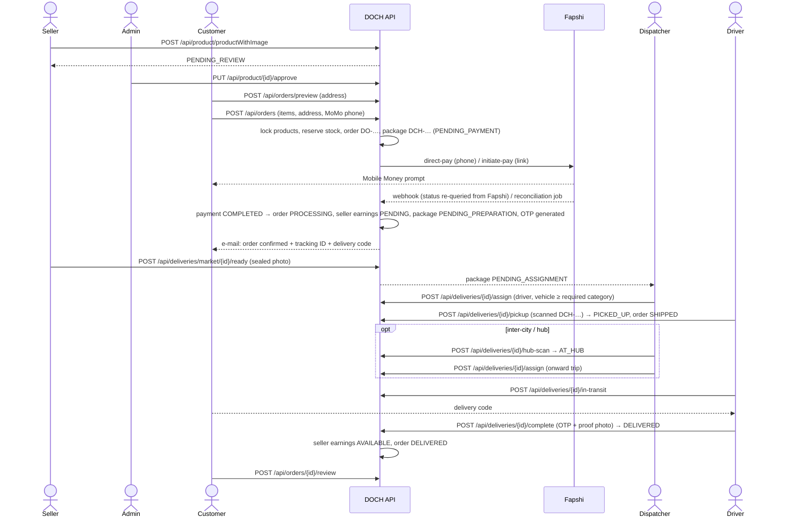
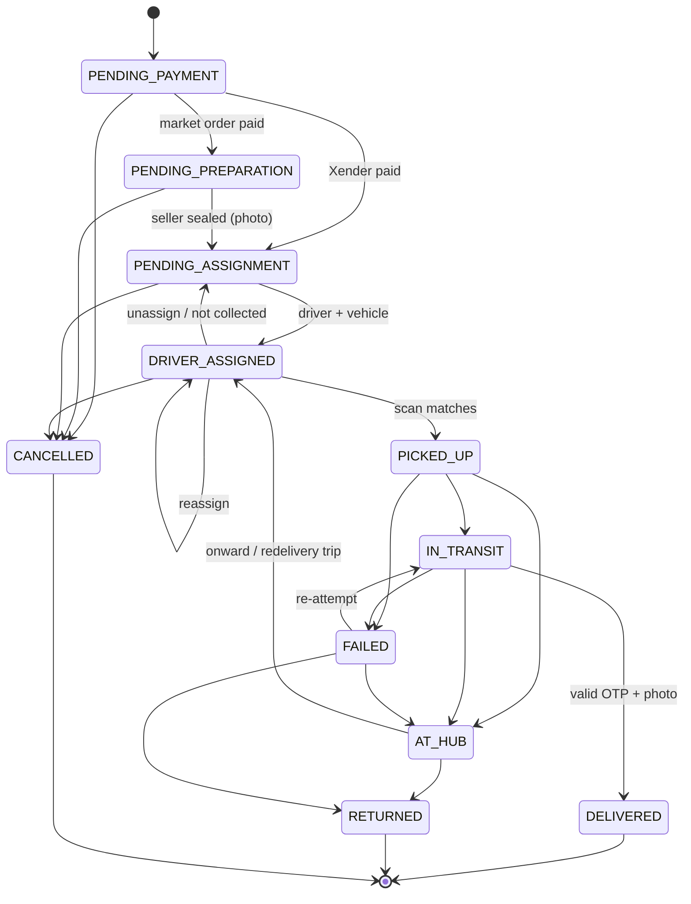
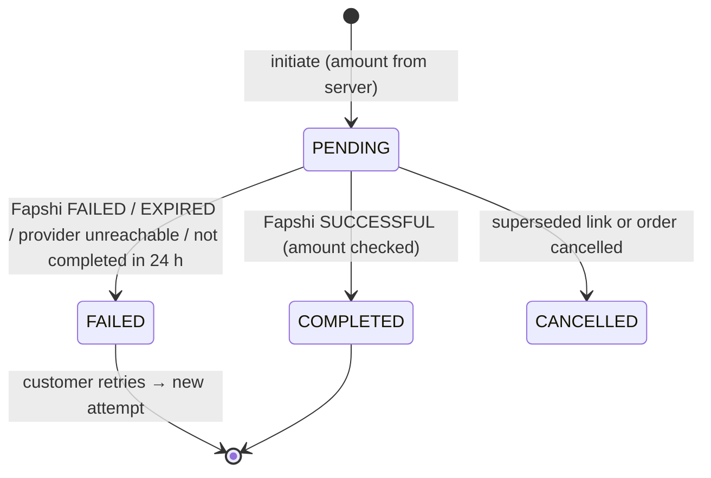

# DOCH — Workflow Validation & Staging Acceptance: Development Team Deliverables

This document answers §14 of the *End-to-End Workflow Validation & Staging Acceptance Test Plan*.

* Automated acceptance run: [`acceptance/run-acceptance.mjs`](../acceptance/run-acceptance.mjs)
* Evidence of the latest full run (43/43 steps passed, record IDs, status changes): [`evidence/acceptance-run-2026-10-30.json`](evidence/acceptance-run-2026-10-30.json)
* Deployment and rollback plan: [`DEPLOYMENT.md`](DEPLOYMENT.md)
* API reference: [`API.md`](API.md) and Swagger UI at `/swagger-ui.html`

---

## 1. Implemented workflows

| Plan § | Workflow | Status | Where it lives |
| --- | --- | --- | --- |
| 3 | **A. Account creation & access control** — customer and seller sign-up with e-mail OTP, admin seller approval/rejection (reason required), driver invitation + activation, role-based permissions enforced server-side, token revocation on logout | Implemented | `User/*`, `common/SecurityConfiguration`, `common/JWTFilter`, Admin *Vendor Agreement*, *User management* |
| 4 | **B. Seller product creation & publication** — product with photo, weight (kg) and dimensions; moderation queue (`PENDING_REVIEW → PUBLISHED / REJECTED`); only published + active products of verified sellers are visible/purchasable; owner-only edit, activate/deactivate | Implemented | `Catalog/*`, Admin *Product moderation*, Seller *Products* |
| 5 | **C. Order placement & payment** — server-side quote per seller (road distance), stock reserved under row lock, unique order reference `DO-XXXXXXXX`, one package per seller with tracking number `DCH-XXXXXXXXXX`; Fapshi payment by phone prompt (direct pay) or hosted link; failed / expired / cancelled / retry; duplicate-callback safe; provider reconciliation job | Implemented | `Order/*`, `Payment/*`, Market *Checkout*, *My orders* |
| 6 | **D. Order visibility & administration** — admin search by order ID, reference, tracking number, customer; status/date filters; pagination; seller view (own items, paid orders only); logistics queue; unauthorized access returns 403/401 | Implemented | Admin *Orders*, Admin *Dispatch*, Seller *Orders* |
| 7 | **E. Dispatch & driver assignment** — seller seals package (photo) → dispatch queue; vehicle decision matrix (Bicycle / Suzuki Carry-K-Truck / Toyota HiAce); assign/reassign/unassign driver **and** vehicle; driver app job list; multi-stop trip with sequence, addresses, package refs, vehicle, status | Implemented | `Logistic/*`, `Fleet/*`, Admin *Dispatch*, *Reports → Fleet*, Driver *Deliveries* |
| 8 | **F. Pickup, hub processing & delivery** — pickup only with matching scan (QR camera or typed code); hub scan (inspect/sort) and onward trip; out for delivery; recipient OTP (6 digits, 5-attempt lockout, supervised reset); proof-of-delivery photo; time, driver, GPS recorded; permitted status sequence enforced by a state machine | Implemented | `Logistic/model/DeliveryStateMachine`, `DeliveryServiceImpl`, Driver *Deliveries*, Admin *Dispatch* |
| 9 | **G. Notifications, ratings & closure** — in-app notifications at every step; e-mails (order confirmation with tracking IDs and delivery codes, package milestones) sent after commit; customer rating + delivery rating (one per delivered order); driver rating computed from reviews; history & reporting | Implemented | `Notification/*`, `common/email/TransactionalEmailListener`, Market *Order detail*, Admin dashboard |
| 10 | **H. Exceptions & recovery** — failed/pending payments; driver unavailable (unassign/reassign); package not collected; recipient unavailable / refused / address not found; incorrect OTP lockout; damaged or mismatched package; rescheduled delivery (scheduled time on reassignment, re-attempt); returns and cancellations (stock restored, seller earnings reversed, refund flagged); network failures (retries, idempotent server); audit trail | Implemented | `FulfilmentService`, `DeliveryServiceImpl`, `OrderServiceImpl`, `common/audit/*` |
| 11 | **Surprise test-data challenge** | Supported by parameters of the acceptance runner and by the UIs | see §5 |

---

## 2. Workflow sequences

### 2.1 Marketplace order (Workflows B → G)



### 2.2 Package status machine (Workflow F / H)



The parent order status is derived from its packages: `PENDING → PAYMENT_FAILED ↔ PENDING → PROCESSING → SHIPPED → DELIVERED`
(or `CANCELLED` / `RETURNED`).

### 2.3 Payment lifecycle (Workflow C)



Webhook payloads are **never trusted**: on every callback the API re-queries `GET /payment-status/{transId}` and applies
the provider's answer under a database row lock, so forged or duplicate callbacks cannot mark a payment as paid twice.
A background job reconciles pending payments every 2 minutes because Fapshi does not retry webhooks.

---

## 3. Data sources and services per module

All modules share **one PostgreSQL database** (schema managed by Flyway `db/migration/V1..V3`) through the single
Spring Boot API. No frontend holds business data locally.

| Module | Frontend | API | Tables | External services |
| --- | --- | --- | --- | --- |
| Accounts / roles | all portals | `/api/auth/**`, `/api/users/me`, `/api/admin/**` | `users`, `roles`, `permissions`, `token`, `verification_token`, `seller`, `driver_profile` | Resend (e-mail OTP / invitations) |
| Catalogue | Market, Seller, Admin | `/api/product/**`, `/api/category/**` | `product`, `product_image`, `category` | S3-compatible object storage (MinIO / Backblaze B2) for photos |
| Orders | Market, Seller, Admin | `/api/orders/**` | `t_orders`, `order_item`, `order_review` | OpenStreetMap Nominatim + OSRM (or Google) for geocoding/road distance |
| Payments / wallets | Market, Xender, Admin | `/api/payments/**`, `/api/wallets/**`, `/api/admin/payouts/**` | `payment`, `payment_splits`, `wallets`, `wallet_transactions` | Fapshi (sandbox / live) |
| Logistics | Admin, Driver, Seller, Market, Xender | `/api/deliveries/**`, `/api/drivers/**`, `/api/tracking/**` | `delivery`, `delivery_event`, `doch_market_delivery_request`, `doch_xender_delivery_request`, `delivery_image`, `location` | object storage (sealed / proof photos) |
| Fleet | Admin | `/api/fleet/**` | `fleet_vehicle` | — |
| Notifications | all portals | `/api/notifications/**` | `notification`, `user_notifications` | Resend (transactional e-mail) |
| Settings | Admin | `/api/settings/pricing` | `pricing_settings` | — |
| Audit | Admin | `/api/admin/audit` | `audit_log` | — |
| Support | Driver, Admin | `/api/support/**` | `support_report` | — |

---

## 4. Test results

| Suite | Command | Result |
| --- | --- | --- |
| Unit tests (state machine, vehicle decision matrix, weight parsing, references, image validation) | `mvn test` | 49 passed (context test skipped unless `DOCH_IT=true`) |
| Schema migration: empty database (V1→V3) and existing Hibernate-managed database (baseline V1 → V2 → V3) + Hibernate `validate` | application start-up | passed |
| End-to-end acceptance, workflows A–H against a fresh database, real Fapshi sandbox payments, real object storage, real e-mail | `node acceptance/run-acceptance.mjs` | **43 / 43 steps passed** — see evidence JSON |
| Frontend compilation of every changed page/composable (5 portals) | Vite dev transform | passed |

Highlights recorded in the evidence file (run `mvuyv4s7`):

* Product **Gari** (1 500 XAF, 2 kg) → order **DO-9C2VEUT8**, quantity 3, total 5 000 XAF, Fapshi reference `VkmADjeuU6`,
  package **DCH-PWHQ9F33S4**: 6 kg → *Suzuki Carry / K-Truck* required, bicycle assignment rejected.
* Journey: `PENDING_PAYMENT > PENDING_PREPARATION > PENDING_ASSIGNMENT > DRIVER_ASSIGNED > PICKED_UP > AT_HUB > DRIVER_ASSIGNED > PICKED_UP > IN_TRANSIT > DELIVERED`.
* Failed payment (sandbox number 670000001) → order `PAYMENT_FAILED`; forged “SUCCESSFUL” webhooks ignored; retry succeeded.
* Three duplicate callbacks → still exactly one set of payment splits, one seller credit, one package.
* Wrong OTP → rejected and counted; 5 wrong codes → locked; even the correct code is refused until dispatch resets it.
* Damaged package → hub → returned: stock restored, pending seller earnings reversed, refund flagged in the audit trail.

---

## 5. Running the acceptance session (including the surprise challenge)

1. Start the stack (see [`DEPLOYMENT.md`](DEPLOYMENT.md)) with Fapshi **sandbox** credentials.
2. Run the automated runner with the data provided on the spot, for example:

   ```bash
   BASE_URL=http://localhost:8080 ADMIN_PASSWORD='***' OTP_DB_NAME=doch \
   PRODUCT_NAME="Gari" PRODUCT_PRICE=1800 PRODUCT_WEIGHT=1.5kg ORDER_QUANTITY=4 \
   CUSTOMER_ADDRESS="Bonamoussadi, Douala, Cameroon" SELLER_ADDRESS="Marche Central, Douala, Cameroon" \
   node acceptance/run-acceptance.mjs
   ```

   (PowerShell: set each variable with `$env:NAME='value'` first.) Every step prints PASS/FAIL and the JSON evidence lists
   all created record IDs. The OTP database is used as the test inbox for e-mail verification codes; real e-mails are also
   sent to `delivered+…@resend.dev`.
3. For the manual demonstration use the portals: Seller → *Products* (create Gari) → Admin → *Product moderation* →
   Market → *Shop/Checkout* (sandbox number **670000000** succeeds, **670000001** fails) → Admin → *Orders* (search the
   `DO-` reference) → Seller → *Orders* (upload sealed photo) → Admin → *Dispatch* (assign driver + vehicle) → Driver →
   *Deliveries* (scan `DCH-` code, out for delivery, enter the customer's code + photo) → Market → *My orders* (tracking,
   rating). Refresh or sign out/in at any step: everything is read from the database.

---

## 6. Known limitations and open items

| # | Item | Impact | Action needed |
| --- | --- | --- | --- |
| 1 | SMS is not integrated (no SMS provider credentials were supplied). Notifications are in-app + e-mail. | Customers without e-mail access rely on the app for the delivery code. | Provide an SMS gateway (e.g. Africa's Talking, Twilio) and credentials; add a sender in `TransactionalEmailListener`. |
| 2 | Refunds are flagged (audit + super-admin notification) but not paid out automatically. Fapshi has no refund API; refunds must be done with a payout. | Manual step for finance. | Decide the refund policy; a payout integration can be added on top of `PAYMENT_REFUND_REQUIRED` audit entries. |
| 3 | Route order is a nearest-neighbour heuristic over the driver's GPS position with pickup-before-drop-off constraints, not a full VRP optimiser; turn-by-turn navigation opens Google Maps. | Good for city trips; not globally optimal for very large multi-stop trips. | Optional: Google Routes / OSRM trip optimisation. |
| 4 | Geocoding: Google Maps key in the dev environment has billing disabled, so `GEO_PROVIDER=osm` (Nominatim/OSRM public servers, rate-limited). | Fine for testing; public servers are not for production volume. | Enable billing on the Google key **or** use a commercial/self-hosted Nominatim + OSRM. |
| 5 | The auth rate limiter is in-memory (per instance). | With several API instances the limit is per instance. | Add a gateway/load-balancer rate limit in production. |
| 6 | Hub operations are performed in the Admin *Dispatch* screen (no dedicated hub-operator role). | Hub staff need an admin account with `ASSIGN_DRIVER`. | Optional `ROLE_HUB_OPERATOR` if required. |
| 7 | Records created on the old demo version (accounts `buyer@doch.com`, `seller@doch.com`, `driver1/2@doch.com`, 7 orders) still exist in the local dev database. They are not used by any code. | None for staging (start from an empty database). | Optionally purge the dev DB before the demonstration. |
| 8 | Seller payouts remain a manual super-admin action (`/api/admin/payouts`). | As designed in the existing code. | — |
